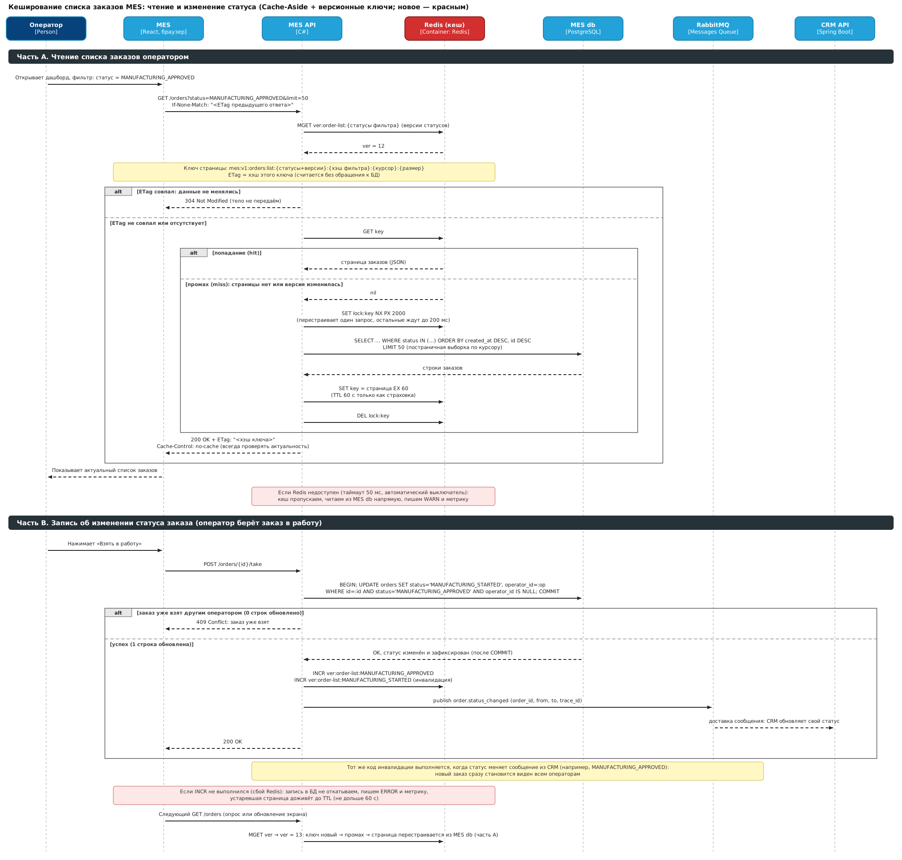
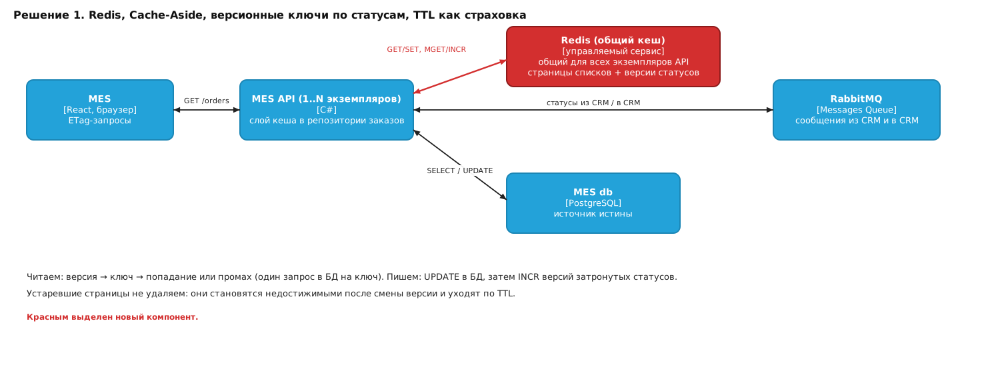
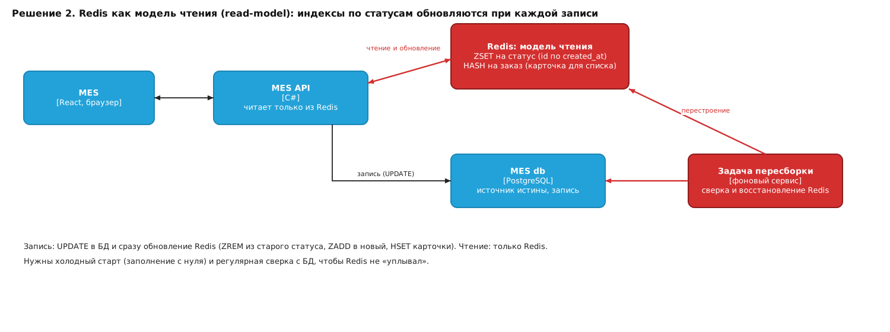
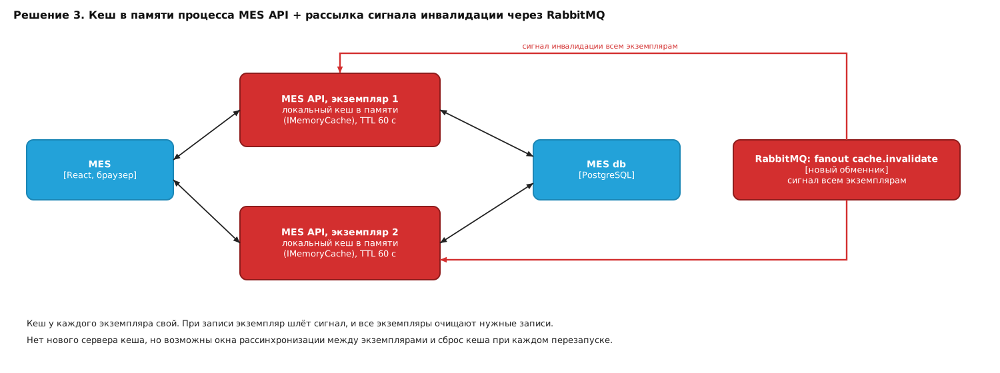

# Архитектурное решение по кешированию

Проект: «Александрит», MES (React + C# MES API + MES db на PostgreSQL).
Связанные документы: «Планирование — анализ, идентификация проблем и поиск решений» (задание 1), «Выбор и настройка мониторинга» (задание 2), «Архитектурное решение по трейсингу» (задание 3), «Архитектурное решение по логированию» (задание 4).

> Все цифры в документе (размеры, доли попаданий в кеш, время ответа) — сценарные оценки для расчёта. Перед внедрением их нужно проверить на реальных метриках из задания 2 (см. раздел 5).

---

## 1. Мотивация

### 1.1. Что происходит сейчас

- Операторы жалуются, что страница MES со списком заказов открывается и обновляется медленно.
- Новых клиентов не устраивает скорость выполнения заказа: пока оператор ждёт страницу, заказ дольше стоит в очереди «до взятия в работу».

Почему так получается (по диаграмме C4 и выводам задания 1):

1. **Весь трафик чтения идёт в одну базу.** Каждый оператор открывает список заказов и регулярно его обновляет. Каждое открытие — это запрос в MES db. Читают все одновременно, а база одна и ещё принимает записи.
2. **MES API — один монолит.** В одном процессе живут список заказов, назначение заказов на операторов, дашборд и расчёт цены (2–30 минут). Тяжёлый расчёт отнимает процессор и соединения с БД у быстрых операций.
3. **Список заказов почти не меняется между запросами.** Заказов в статусах «ждёт взятия» или «в работе» — десятки или сотни, а статус меняется раз в минуты. Но каждый раз список собирается заново.
4. **Данные дублируются** (Shop DB и MES db), и MES db получает нагрузку ещё и от синхронизации статусов через RabbitMQ.

### 1.2. Что должно дать кеширование

| Цель | Как это измеряем (метрики из задания 2) |
|---|---|
| Страница списка заказов открывается быстро | Latency p95 по `GET /orders` — цель ≤ 300 мс (сейчас сценарная оценка 1–3 с в часы пик) |
| База не перегружена повторяющимися чтениями | Число запросов в MES db в секунду, CPU и число соединений БД — минус 70–90 % запросов на чтение |
| Расчёт цены и другие тяжёлые операции не «душат» чтение | Доля ошибок 5xx и saturation процессора MES API |
| Операторы всегда видят актуальные данные | Доля «устаревших» ответов — цель 0 после подтверждения записи (см. раздел 2.5) |
| Решение работает и без кеша | Время ответа при падении Redis не хуже текущего |

### 1.3. Что именно кешируем

Кешируем то, что **читают часто, а меняют редко**:

| Что | Кешировать? | Почему |
|---|---|---|
| Страницы списка заказов по статусам (то, что операторы видят в MES) | **Да — главное** | Самое частое чтение, одинаковое для многих операторов |
| Карточка заказа для просмотра (заказ по id) | **Да** | Часто открывают повторно, мало меняется |
| Справочники (типы изделий, материалы, статусы, список операторов) | **Да** | Почти не меняются |
| Результат расчёта цены | **Только после замера** | Расчёт дорогой, но входные данные (3D-модель, материал) у каждого заказа свои — доля повторов может быть низкой. Это гипотеза: сначала считаем, как часто пересчитываются одни и те же входные данные |
| Операция «взять заказ в работу» и любые записи | **Нет** | Запись всегда идёт в БД; кешируется только чтение |
| Данные, зависящие от конкретного пользователя и содержащие персональные данные (адреса, контакты клиентов) | **Нет** | Низкий коэффициент повторного чтения и риск утечки |
| 3D-файлы | **Нет** | Они в S3, кеширует их сам S3 / CDN, это не наша проблема |
| Дашборд | **Нет сейчас** | Выносится из MES API отдельной инициативой (задание 1) |

**Какие элементы системы затрагиваем:** MES (браузер оператора), MES API, MES db — и один **новый элемент: Redis**. Shop API, CRM, Shop DB и интернет-магазин не меняются; RabbitMQ используется как есть.

---

## 2. Предлагаемое решение

### 2.1. Клиентское или серверное кеширование

| Критерий | Клиентское (браузер) | Серверное (общий кеш) |
|---|---|---|
| Что делает | Браузер запоминает ответ и не ходит на сервер, пока срок не истёк | Сервер хранит готовые ответы в быстром хранилище и не ходит в БД |
| Нагрузка на MES db | Снижает, но каждый оператор всё равно один раз приходит за данными | Снижает для **всех** операторов сразу: первый запрос заполняет кеш для остальных |
| Актуальность данных | Сервер не может «выбросить» данные у операторов — они устаревают на весь срок кеширования | Сервер сам сбрасывает кеш в момент изменения |
| Критичность для бизнеса | **Опасно:** оператор может видеть заказ «свободным», хотя его уже взяли. Оплата работы зависит от того, кто взял заказ первым | Можно сделать так, чтобы устаревших данных не было |
| Сложность | Низкая (заголовки HTTP) | Выше: новый компонент, инвалидация |

**Решение: серверное кеширование как основа + лёгкая клиентская проверка.**

- **Серверное** — главный механизм (Redis, общий для всех экземпляров MES API).
- **Клиентское в «безопасной» форме:** браузер не хранит данные «на время», а **проверяет** их у сервера через `ETag` / `If-None-Match`. Если список не менялся, сервер отвечает `304 Not Modified` без тела: ответ быстрый и маленький, а данные при этом всегда свежие. Кеш с «временем жизни» на клиенте (`Cache-Control: max-age`) для списков **не используем**.
- Для статичных справочников допустим `Cache-Control: max-age=300`, потому что они меняются редко и ошибка в них не влияет на деньги.

**Почему не только клиентское:** оно не может быть мгновенно сброшено сервером и не снимает нагрузку с базы при одновременном заходе всех операторов в начале смены.

### 2.2. Паттерн: Cache-Aside, Write-Through или Refresh-Ahead

| Критерий | **Cache-Aside** (выбран) | Write-Through | Refresh-Ahead |
|---|---|---|---|
| Как работает | Читаем кеш; если там нет — читаем БД и кладём в кеш. При записи пишем в БД и объявляем кеш устаревшим | Каждая запись идёт сначала в кеш и сразу в БД в одной операции | Кеш сам заранее обновляет данные, пока не истёк срок |
| Что хорошо | Простота. Кеш содержит только то, что реально читают. Если Redis упал, система работает через БД | Кеш всегда свежий после записи | Нет «холодного» первого запроса после истечения срока |
| Проблемы для нас | Первый запрос после сброса медленный; нужна защита от «толпы» запросов (см. 2.5) | Список заказов — это **выборка** (страница по статусу, сортировка, лимит). Обновить её при записи одного заказа — значит пересобрать все страницы, куда заказ мог попасть. Это сложнее и дороже самого запроса. Если запись в кеш упала, а в БД прошла — расхождение. Redis становится обязательным компонентом записи | Нужно уметь предсказывать, какие страницы понадобятся. Заказов мало, статусы меняются часто (каждое изменение делает данные устаревшими) — прогрев будет постоянно работать вхолостую |
| Подходит? | **Да** | Нет: сложно для списков, добавляет Redis в критический путь записи | Нет как основной. Допустим только лёгкий прогрев первых страниц после перезапуска |

**Почему именно Cache-Aside:**

1. Кеш — вспомогательная часть. При его отказе система замедляется, но не ломается (при записи мы всё равно пишем только в БД).
2. Подходит для чтения выборок: ключом служит «статус + страница + параметры сортировки».
3. Единственная запись в MES db идёт через MES API — значит, в одном месте можно гарантированно сообщать кешу об изменении.
4. Просто реализовать (слой над репозиторием заказов) и просто объяснить команде.

### 2.3. Что хранится в кеше (структура)

| Ключ | Значение | Срок жизни (TTL) | Примерный размер |
|---|---|---|---|
| `orders:list:{status}:v{ver}:{sort}:{cursor}` | Страница списка (до 50 заказов, краткие поля для списка, без персональных данных клиента) в JSON | 60 с | 15–40 КБ |
| `orders:ver:{status}` | Целое число — версия статуса. Растёт на 1 при каждом изменении набора заказов этого статуса | без срока | 8 байт |
| `orders:card:{orderId}:v{ver}` | Карточка заказа | 300 с | 3–8 КБ |
| `ref:{name}` | Справочники | 600 с | единицы КБ |
| `lock:{key}` | Блокировка заполнения от «толпы» запросов | 5 с | — |

Примерная оценка: 10 статусов × 3 сортировки × ~5 страниц × 30 КБ ≈ 5–10 МБ активных данных. Это очень мало; даже минимальный управляемый Redis (1–2 ГБ) хватит с большим запасом. Политика вытеснения при нехватке памяти: `allkeys-lru`.

**Пагинация:** вместо «страница №N» используем курсор по `created_at, id` (keyset). Так страницы не «съезжают», когда в список добавляется заказ, и ключи кеша остаются стабильными.

### 2.4. Диаграмма последовательности

Диаграмма показывает два сценария и всех участников кеширования.

**Участники:**

| Участник | Роль в кешировании |
|---|---|
| Оператор / MES (React) | Запрашивает список; хранит `ETag` последнего ответа и присылает его в `If-None-Match` |
| MES API | Единственный владелец логики кеша: слой над репозиторием заказов читает и заполняет кеш, увеличивает версии при записи |
| Redis | Общий кеш всех экземпляров MES API: страницы списков, карточки, счётчики версий, блокировки |
| MES db (PostgreSQL) | Источник истины. Читается только при промахе кеша; запись всегда сюда |
| RabbitMQ | Сообщение `order.status_changed` о смене статуса уходит в CRM API (как и сейчас); кеша напрямую не касается |
| CRM API | Получатель сообщения; к кешу не имеет доступа |

**Сценарий А. Чтение списка заказов**

1. MES запрашивает `GET /orders?status=…` и отправляет `If-None-Match` с `ETag` предыдущего ответа.
2. MES API одним запросом `MGET` читает версии нужных статусов из Redis.
3. ETag строится из версий статусов. **Если ETag совпал** — отвечаем `304 Not Modified` (ни кеш страниц, ни БД не трогаем).
4. Иначе формируем ключ страницы (с версией) и читаем его из Redis:
   - **попадание** — отдаём JSON из кеша;
   - **промах** — берём блокировку `SET lock NX PX 5000`; кто её получил, читает БД (`SELECT … LIMIT 50`), кладёт результат в Redis (`SET … EX 60`), снимает блокировку. Остальные параллельные запросы ждут 50–100 мс и перечитывают ключ — база получает один запрос вместо сотни.
5. Ответ `200 OK` с новым `ETag`.

**Если Redis недоступен:** MES API прекращает обращаться к нему на 10–30 секунд (circuit breaker) и читает прямо из БД. Операторы видят медленнее, но верно.

**Сценарий Б. Изменение статуса (оператор берёт заказ в работу)**

1. MES отправляет `POST /orders/{id}/take`.
2. MES API выполняет в БД **условное** обновление:
   `UPDATE orders SET status='IN_PROGRESS', operator_id=:op WHERE id=:id AND status='ASSIGNED_FOR_PICKUP' AND operator_id IS NULL`.
   Если затронуто 0 строк — заказ уже взял другой оператор: возвращаем `409 Conflict`, кеш не меняем.
3. После `COMMIT` MES API увеличивает версии (`INCR orders:ver:{старый статус}` и `INCR orders:ver:{новый статус}`) — теперь все старые страницы списков недостижимы.
4. Публикуется `order.status_changed` в RabbitMQ → CRM API (как сейчас).
5. Ответ `200 OK`. Следующий запрос списка увидит новую версию, получит промах и подтянет свежие данные из БД.

Важный порядок: сначала `COMMIT` в БД, потом `INCR`. Тогда, если между ними сбой, мы не получим новый кеш со старыми данными.

### 2.5. Стратегия инвалидации

**Выбрано: программная (событийная) инвалидация через версионные ключи + TTL 60 с как страховка.**

Идея простая: вместо того чтобы искать и удалять все страницы, куда мог попасть заказ, мы меняем «номер версии» статуса. Ключ страницы содержит этот номер — после изменения старые страницы просто перестают находиться и сами исчезают по TTL.

**Почему подходит нам:**

- Все записи в MES db идут через MES API — есть единое место, где мы знаем, что данные поменялись.
- Операторам нужна актуальность «сразу»: оплата зависит от того, кто первый взял заказ. Мгновенно срабатывает только программная инвалидация.
- Не нужно перебирать ключи (команда `KEYS` в Redis на больших кешах блокирует сервер) и не нужно знать, на каких страницах оказался конкретный заказ.
- Две версии (старого и нового статуса) покрывают оба списка, которые затронуты переходом.

**Сравнение стратегий:**

| Критерий | Временная (TTL) | По ключу (удалить конкретные ключи) | **Программная: версии статусов + TTL** (выбрана) | Тегами (набор ключей на тег) |
|---|---|---|---|---|
| Актуальность | Устаревает до конца TTL (до 60 с и больше) | Мгновенная, если нашли все ключи | Мгновенная | Мгновенная |
| Сложность | Минимальная | Высокая: нужно знать все страницы, где мог быть заказ | Средняя: счётчик на статус | Средняя/высокая: список ключей на каждый тег, чистка тегов |
| Риск ошибки | Показ устаревшего списка — **недопустимо** для нас | Забыли ключ → вечная устаревшая страница | Низкий: что-то пропустили — исправит TTL | Рассинхрон тегов и ключей |
| Нагрузка на Redis | Низкая | Много `DEL` | Две `INCR` на запись | Много операций над множествами |
| Годится как единственная стратегия? | Нет | Нет | **Да (+ TTL как страховка)** | Избыточно |

**Как закрываем остальные риски:**

| Риск | Что делаем |
|---|---|
| Кто-то меняет MES db мимо MES API (скрипт, миграция) | Правило: любые изменения заказов только через MES API. После ручной правки в БД — ручной `INCR` версий (команда в runbook) или ожидание 60 с TTL |
| `INCR` не выполнился (Redis недоступен в момент записи) | Запись в БД не откатываем. Ставим флаг в логе/метрику ошибки инвалидации и принудительно обходим кеш (читаем из БД) до восстановления Redis; после восстановления версии «поднимаются» за счёт `INCR` всех статусов. Максимум устаревания ограничен TTL 60 с |
| Изменения, пришедшие из CRM (через RabbitMQ) | Обработчик сообщений в MES API делает ту же последовательность «БД → `COMMIT` → `INCR`» |
| «Толпа» запросов в момент сброса | Блокировка заполнения `SET NX PX` + короткое ожидание остальных |
| Гонка: чтение читает БД до коммита и кладёт старое в кеш под новой версией | Версию читаем **до** `SELECT`, а ключ строим по этой версии. Если версия выросла во время чтения, запись попадёт под старый ключ, который уже недостижим |
| Redis перезапустился и потерял данные | Это допустимо: кеш пустой, версии начинаются заново с 0 — чтобы не получить совпадение с прошлыми ключами, в ключ добавляем «эпоху» (`epoch` — время старта кеша, хранится в `orders:epoch`) |

### 2.6. Эксплуатация и безопасность

- **Redis — управляемый сервис** (как и PostgreSQL): репликация на второй узел, автоматическое переключение, резервные копии не обязательны (кеш восстановим).
- **Доступ:** только из сети MES API, пароль/ACL, шифрование соединения (TLS).
- **Персональные данные в кеше не хранятся**: только краткие поля заказа для списка (номер, статус, тип изделия, срок, оператор). Контакты и адреса клиента берутся из БД только при открытии карточки и в кеш не попадают.
- **Мониторинг** (добавляем в Grafana из задания 2):
  - hit ratio (цель ≥ 85 % по спискам),
  - latency Redis p95 (цель < 5 мс),
  - evicted keys (должно быть около нуля),
  - память Redis (алерт на 70 %),
  - число срабатываний circuit breaker, число ошибок `INCR`,
  - время ответа `GET /orders` с разбивкой «попадание / промах / 304».
- **Логирование и трейсинг:** в лог (INFO) пишем только изменения режима (кеш выключен/включён); в трейс добавляем атрибут `cache.result = hit|miss|bypass|not_modified` — по нему видно, сколько времени запрос провёл в Redis, а сколько в БД.

---

## 3. Дополнительное задание: альтернативные решения

Мы рассмотрели три решения.

### Решение 1. Redis, Cache-Aside, версионные ключи (рекомендуемое)

Описание: общий Redis, слой кеша в MES API. Чтение — через кеш, запись — в БД с увеличением версий статусов. Подробно описано в разделе 2.

### Решение 2. Redis как модель чтения (read-model)

Описание: в Redis хранится не «копия ответов», а собственная структура для чтения: для каждого статуса отсортированное множество (`ZSET`) идентификаторов, для каждого заказа — карточка (`HASH`). Список читается только из Redis. При каждой записи MES API обновляет БД и затем Redis (`ZREM` из старого статуса, `ZADD` в новый, `HSET` карточки). Холодный старт — полная загрузка из БД; фоновая задача регулярно сверяет Redis с БД.

### Решение 3. Локальный кеш в памяти MES API + сигнал инвалидации через RabbitMQ

Описание: каждый экземпляр MES API держит кеш в собственной памяти (`IMemoryCache`, TTL 60 с). Когда один экземпляр записывает изменение, он публикует сообщение в обменник `fanout` RabbitMQ; все экземпляры получают его и очищают нужные записи.

### Сопоставление

| | **Решение 1.** Redis + Cache-Aside + версии | **Решение 2.** Redis как read-model | **Решение 3.** Локальный кеш + RabbitMQ |
|---|---|---|---|
| Описание и диаграмма | Раздел 2, рисунок выше | Рисунок выше | Рисунок выше |
| **Плюсы** | • Один общий кеш для всех экземпляров • Простая и понятная схема • Мгновенная актуальность через версии • Redis упал — работаем через БД • Нет персональных данных в кеше | • Самое быстрое чтение: база не нужна совсем • Можно дёшево делать фильтры и счётчики по статусам • Хороший задел для дашборда | • Нет нового сервера и нет сетевого вызова: чтение за микросекунды • Дешевле всего по инфраструктуре • Использует уже имеющийся RabbitMQ | 
| **Минусы** | • Новый компонент (Redis) и его эксплуатация • Первый запрос после сброса идёт в БД (смягчено блокировкой) • Нужно соблюдать правило «пишем только через MES API» | • Это уже вторая копия данных: нужна синхронизация и сверка • Redis становится частью пути записи: сбой после записи в БД оставляет рассинхрон до сверки • Redis упал — читать неоткуда, нужен полный запасной путь и перестроение • Намного больше кода и тестов; любые новые фильтры требуют новых индексов в Redis | • Сообщение инвалидации может прийти с задержкой или потеряться — окно рассинхронизации между экземплярами. Для заказов «кто первый» это недопустимо • Кеш пропадает при каждом перезапуске и деплое • Каждый экземпляр держит свою копию — больше нагрузка на БД при росте числа экземпляров • Сложно проверять и разбирать, что именно видит каждый экземпляр |
| Сложность внедрения | Средняя | Высокая | Средняя (но сложная отладка) |
| Риск показать устаревшие данные | Низкий | Низкий, но выше при сбоях синхронизации | Средний/высокий |
| Подходит под требование «оператор всегда видит актуальное» | Да | Да, при сверке | Нет |

### Заключение

**Рекомендуем Решение 1.**

- Оно закрывает главную проблему (медленный список и перегрузка БД) с минимальным риском: если кеш недоступен, система работает как сейчас.
- Только оно одновременно простое, даёт мгновенную актуальность и не создаёт второй источник истины.
- Решение 2 даёт больше скорости, но стоит дороже в разработке и поддержке; его стоит рассматривать позже, если дашборд или число операторов вырастут так, что и кеш страниц перестанет справляться.
- Решение 3 дешевле, но в нём не гарантируется мгновенная актуальность между экземплярами — для распределения заказов между операторами это неприемлемо. Локальный кеш допустим лишь для неизменяемых справочников.

---

## 4. План внедрения

| Шаг | Что делаем | Результат |
|---|---|---|
| 1 | Замеряем базовые метрики: latency `GET /orders`, запросы в БД, долю повторяющихся запросов, число экземпляров MES API | Точка отсчёта и подтверждение гипотез |
| 2 | Поднимаем управляемый Redis, подключаем мониторинг | Готовая инфраструктура |
| 3 | Слой кеша над репозиторием заказов (Cache-Aside, версионные ключи), `ETag` на `GET /orders` | Ускорение чтения списка |
| 4 | Условное обновление при взятии заказа + `INCR` версий после `COMMIT`, обработка сообщений из CRM по тому же пути | Корректная инвалидация |
| 5 | Circuit breaker, защита от «толпы», тесты на отказ Redis | Устойчивость |
| 6 | Включаем для 10 % операторов (feature flag), сравниваем метрики, затем для всех | Безопасное внедрение |
| 7 | Решаем по кешу расчёта цены — после измерения доли повторов | Только если замер оправдывает |

## 5. Ограничения и риски

- Кеширование снимает нагрузку на чтение, но **не устраняет** главную причину перегрузки — монолитный MES API (расчёт цены в одном процессе с остальным). Вынесение расчёта цены в отдельный сервис остаётся инициативой из задания 1; кеширование её дополняет, а не заменяет.
- Все цифры (размеры кеша, ожидаемая доля попаданий, целевые времена) — оценки для расчёта; уточняются на шаге 1 плана.
- Решение работает при условии, что все записи в MES db идут через MES API. Это правило нужно закрепить в регламенте и в доступах к БД.
- Если число экземпляров MES API всегда будет равно 1, локальный кеш становится проще, но мы всё равно рекомендуем Redis: он переживёт перезапуск и подготовит систему к масштабированию.
